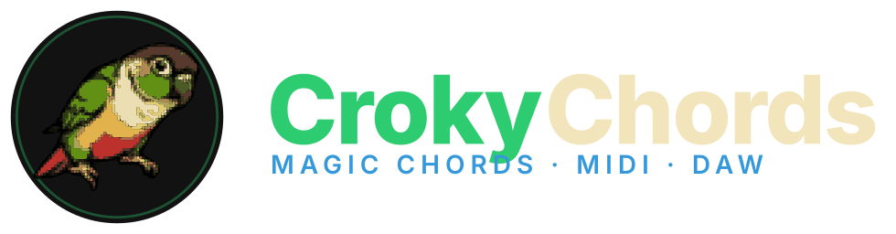

<p align="center"></p>

# Croky Chords

A chord-progression editor that suggests the next chord from statistics over real songs.
The web app comes first; MIDI export and DAW output exist today and grow into a plugin later.

> **Status:** core, data builders and the web editor are implemented (see `docs/ROADMAP.md`).
> Multi-channel tracks ("band") are in progress. Start with [`docs/HANDOVER.md`](docs/HANDOVER.md).

## What it does (and will do)

- **Chord grid editor** in the browser: pick a key and tempo, add chords, set their duration in beats.
- **Next-chord panel**: given the chords you already have, show which chord most often comes next,
  with percentages. The suggestions come from an n-gram (Markov) model over Roman-numeral chord
  tokens, trained on real song data.
- **Playback** via Web Audio, **`.mid` export**, and **Web MIDI out** so the progression can drive a
  DAW today through a virtual MIDI port (loopMIDI on Windows, IAC on macOS, ALSA virtual port on Linux).
- **Later:** a native MIDI-effect plugin (CLAP/VST3) with the same suggestion engine inside your DAW.

## Repository layout

```
crokychords/
├── packages/core/    Pure TypeScript: music theory, chord model, n-gram suggestion engine,
│                     MIDI file writer, song JSON format. No DOM, fully unit-tested.
├── apps/web/         Vite + TypeScript web app: chord grid, suggestion panel, playback,
│                     .mid download, Web MIDI output, localStorage save/load.
├── packages/data/    Python scripts that build the n-gram tables (see "Data" below).
├── docs/             HANDOVER.md, WORKFLOW.md, ARCHITECTURE.md, ROADMAP.md, DATA.md, adr/
└── .claude/          Agents, skills and hooks for the Claude Code workflow.
```

`packages/core` and `apps/web` are pnpm workspace packages. `packages/data` is a standalone Python
project; it only has to produce an `ngrams.json` file that `core` can load.

## Getting started

Requirements: Node 22+ (see `.nvmrc`), pnpm 10 (`corepack enable` gives you the pinned version),
and Python 3.11+ if you want to rebuild the data.

```bash
corepack enable
pnpm install
pnpm dev          # start the web app
pnpm check        # lint + format check + typecheck + tests + build
```

Other scripts: `pnpm build`, `pnpm test`, `pnpm typecheck`, `pnpm lint`, `pnpm format`.

## Chord token format

All data and the suggestion engine speak one token format: Roman numerals relative to the key.

| Token      | Meaning                                  |
|------------|------------------------------------------|
| `I`, `IV`  | major triads (uppercase)                 |
| `ii`, `vi` | minor triads (lowercase)                 |
| `vii°`     | diminished, `III+` augmented             |
| `V7`, `ii7`, `Imaj7`, `iiø7`, `vii°7` | seventh chords    |
| `bVII`, `bVI` | borrowed chords, accidental in front  |
| `vi/1`, `V/2` | inversions: `/1` first, `/2` second, `/3` third |

An n-gram table maps a comma-separated context (`"IV,I"`, or `""` for unigrams) to the
probability of each following token. Major and minor keys have separate tables.

## Data

The suggestion tables are built by `packages/data` from **Chordonomicon**
(`crokychords_data/chordonomicon_build.py`), an open dataset of ~680k songs with chord
annotations. Chords there are absolute (`C G Amin F`), so the script estimates each song's key and
converts to Roman numerals before counting n-grams.

A small hand-seeded table ships with `core` so the app works without any download.

**Licensing:** Chordonomicon is CC-BY-NC-4.0, which rules it out for a commercial plugin. Use your
own analyses or a permissively licensed dataset for anything you intend to sell. Details in
`docs/DATA.md`.

## Roadmap

1. Finish the scaffold: package manifests, lockfile, CI running `pnpm check`.
2. `packages/core`: theory, chords, progression model, n-gram suggestions with backoff, MIDI writer.
3. `apps/web`: editor, suggestion panel, playback, export, Web MIDI out.
4. `packages/data`: both data builders plus tests.
5. Documentation and architecture decision records.
6. Native plugin, most likely Rust + [`nih-plug`](https://github.com/robbert-vdh/nih-plug)
   (CLAP/VST3 MIDI effect). The engine is a small lookup over JSON data, so porting is cheap.

## Development workflow

This repo is developed with Claude Code. The main session plans and reviews; implementation agents
work in small pull requests, and every PR gets a code review before merge. Conventions, agent
definitions and skills live under `.claude/`. Start a new session by reading
[`docs/HANDOVER.md`](docs/HANDOVER.md).

## License

Not yet decided. See the licensing note under "Data" before reusing the datasets.
