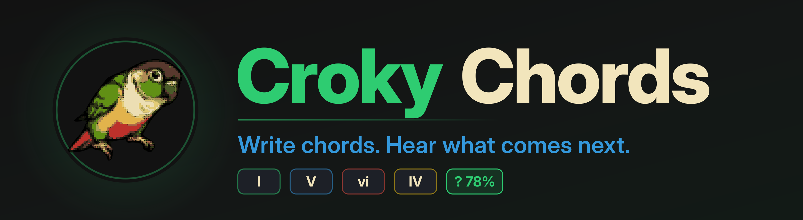
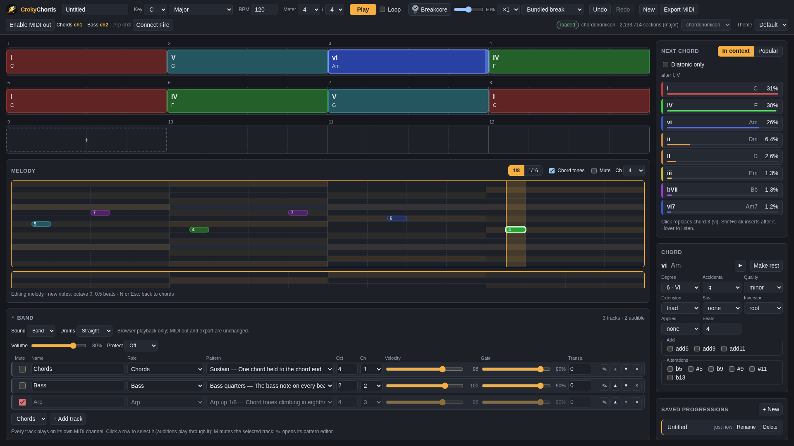
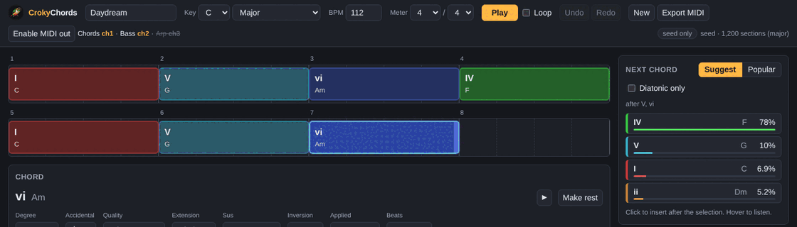

<p align="center">
  
</p>

<p align="center">
  <a href="https://github.com/ennes-ns/crokychords/actions/workflows/ci.yml"></a>
  
  
  <a href="LICENSE"></a>
</p>

Croky Chords is a chord-progression editor for the browser. You lay out chords on a grid, and a
panel next to it tells you which chord most often comes next in real songs, with percentages. You
can hear the progression with a small band, export it as a `.mid` file, or send it straight to a
DAW over Web MIDI.

<p align="center">
  
</p>

## Try it locally

```bash
mise install        # Node 22, pnpm 10 (or install them yourself)
pnpm install
pnpm dev            # http://localhost:5173
```

`pnpm check` runs lint, format check, typecheck, tests and build; CI runs the same.

## What it does

<p align="center">
  
</p>

- **Grid editor.** Pick a key, tempo and meter; add chords by clicking a suggestion or pressing `1`–`7`;
  edit degree, quality, extension, inversion and beats in the chord panel. Undo/redo, autosave.
- **Next-chord suggestions.** After the chords you already have, the most likely next chords with
  their probability, from an n-gram model over Roman-numeral chord tokens. "Popular" shows the most
  common chords in the key instead; "diatonic only" filters out borrowed chords. Hover to listen.
- **Playback.** A band of tracks (chords, bass, arpeggio, …) with pattern presets, octave, velocity,
  gate and a MIDI channel per track, played by a Web Audio synth. A step-grid pattern editor per
  track draws arpeggios and rhythms and saves them as song presets.
- **Export.** Download the progression as a multi-track `.mid` file.
- **Web MIDI out.** Drive a DAW or hardware synth live through a virtual MIDI port, one channel per track.
- **Sampler and community bank.** Load your own samples into eight sampler slots (root, trim,
  loop, envelope, filter). In the online version you can share a sample: after the maintainer has
  listened to it, every signed-in user can audition it and add it to a slot. Unsharing stops new
  takes; whoever already has it keeps it ([`docs/specs/community-v1.md`](docs/specs/community-v1.md)).
- **Akai Fire.** Connect an Akai Fire (Chrome/Edge, Web MIDI with SysEx) to build the progression
  on its pads and edit the sampler on the device: the DRUM button opens SAMPLE mode with the slots,
  a keyboard around the root and four knob pages on the OLED
  ([`docs/specs/akai-fire-v1.md`](docs/specs/akai-fire-v1.md)).
- **Assistant and command API.** Ask the built-in assistant for a change ("make the second half
  darker") and review it as a diff before applying it; scripts and agents use the same JSON
  commands through `window.croky` or the terminal app ([`docs/howto/agents.md`](docs/howto/agents.md)).
  The assistant is hidden (no button, no Ctrl/Cmd+K) until it is switched on: with the API it
  needs `ANTHROPIC_API_KEY` and the Worker var `ASSISTANT_ENABLED="true"` (default `"false"` in
  `apps/api/wrangler.toml`); a build without the API shows it only with `VITE_ASSISTANT=on`. The
  command API is always there.

<details>
<summary><b>How the suggestions work</b></summary>

Every chord is a token relative to the key: `I`, `IV`, `vi`, `V7`, `bVII`, `vii°`, `ii7/1`, … One
grammar everywhere, `roman-numeral-v1` (see [`packages/data/README.md`](packages/data/README.md)).

The suggestion table is an n-gram count per mode: for each context (the last one, two or three
tokens) it stores how often each next token followed. Lookup uses the longest context that has
enough observations and backs off to shorter ones, down to the plain chord frequencies.

```ts
import { seedTable, suggestNext } from '@crokychords/core';

const next = suggestNext(seedTable, 'major', ['I', 'V', 'vi']);
for (const s of next.slice(0, 3)) {
  console.log(s.token, `${Math.round(s.probability * 100)}%`, s.contextUsed.join(','));
}
// IV 78% V,vi
// V  10% V,vi
// I  7%  V,vi
```

`seedTable` is the small hand-seeded table that ships with `@crokychords/core`; the app loads a
larger one from `apps/web/public/data/ngrams.json` when present.

</details>

## Where it stands

| Part            | State                                                                                                         |
| --------------- | ------------------------------------------------------------------------------------------------------------- |
| `packages/core` | Done: theory, chord tokens, song model with tracks, n-gram suggestions with backoff, MIDI writer. Unit-tested. |
| `packages/data` | Done: builds the suggestion tables from Chordonomicon; a trimmed default table ships with the app.             |
| `apps/web`      | Done for v1: grid editor, next-chord panel, instruments and presets, band panel, saved progressions, themes, `.mid` export, Web MIDI out. |
| Brand           | Done: pixel banner, favicon and mark from one pixel master (`docs/readme/`, `tools/brand/`, `docs/BRAND.md`).  |
| CI              | `pnpm check`, the data tests and `rust check` (cargo fmt, clippy, tests, golden freshness), required on `main`. |
| Online version  | Live for invited users at `chords.cr0ky.com` (Cloudflare Worker, D1, R2, Access).                            |

## Repository

```
crokychords/
├── packages/core/   Pure TypeScript: theory, chord tokens, song model, suggestions, MIDI writer.
│                    No DOM or Node APIs, so it can be ported to a native plugin later.
├── apps/web/        Vite + TypeScript editor: grid, next-chord panel, band, playback, export, MIDI out.
├── packages/data/   Python builders for the suggestion tables.
├── crates/          Rust: port of core + terminal prototype (spike, docs/specs/tui-v1.md).
└── docs/            ARCHITECTURE.md, WORKFLOW.md, HANDOVER.md, ROADMAP.md, BRAND.md, specs/, adr/
```

## Data

The suggestion tables are built from Chordonomicon, an open dataset of chord annotations for
hundreds of thousands of songs; the chords are converted to Roman numerals per song before counting.
The app ships with a small hand-seeded table so it works without a data build. Suggestion data
derived from Chordonomicon (CC BY-NC 4.0).

## Roadmap

Plans, not promises:

- Built-in instruments and presets for playback.
- An online version with accounts and cloud saves.
- Later, a native MIDI-effect plugin (CLAP/VST3) with the same suggestion engine inside your DAW.

## Contributing

Work is tracked in GitHub Issues: `ready` means an agent or a person can start, `blocked` waits for a
decision, `in-review` has a PR. One issue is one branch is one PR, with green `pnpm check`. The
process and the review rules are in [`docs/WORKFLOW.md`](docs/WORKFLOW.md); the technical conventions
in [`CLAUDE.md`](CLAUDE.md).

## License

MIT, see [`LICENSE`](LICENSE).
